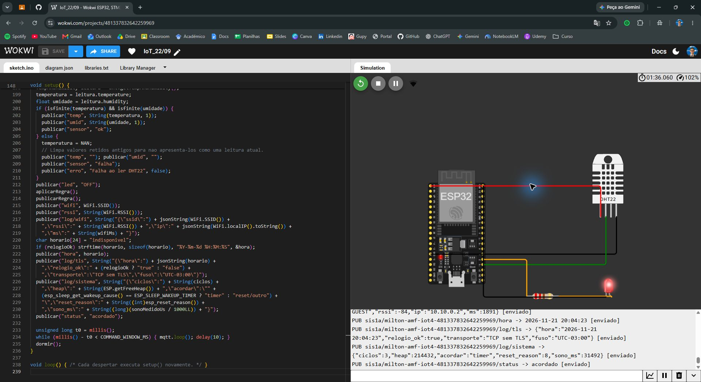
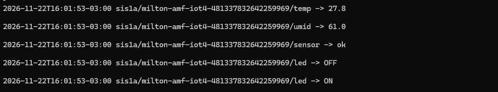
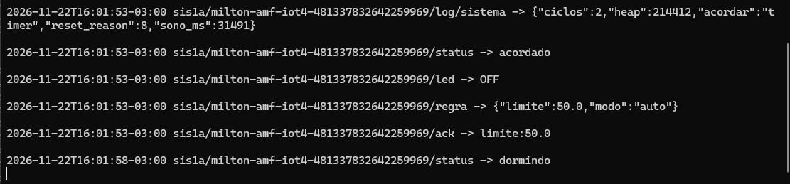

# Entrega — MQTT com Mosquitto

**Disciplina:** Internet das Coisas (IoT) — AMF 2026-02  
**Aluno(s):** Milton Roberto e Marcelo Telles  
**Nome MQTT:** `milton-amf-iot4-481337832642259969`  
**Validação da simulação:** 21/11/2026  
**Revisão local e compilação:** 22/11/2026  
**Ambiente:** Wokwi, ESP32 virtual, DHT22 e serviço Python. Não foi utilizada placa física.

A simulação usa DHT22 no GPIO 15; a versão para placa física usa DHT11 no GPIO 4.
Essa adaptação está documentada em `wokwi/README.md`. O enunciado original não
está incluído no projeto, portanto a conformidade dessa substituição com os
critérios do professor não foi confirmada.

**Projeto:** [Abrir no Wokwi](https://wokwi.com/projects/481337832642259969).

## Respostas

### 1. Explique pub/sub: o que é publicar, assinar e qual o papel do broker?

Publicar é enviar uma mensagem para um tópico. Assinar é escolher os tópicos dos
quais se deseja receber mensagens. O broker recebe as publicações e as entrega
aos clientes que assinaram esses tópicos.

### 2. Por que separar em vários tópicos é melhor do que mandar tudo num só? Cite uma vantagem.

Separar os tópicos organiza as informações e permite receber apenas o necessário.
Por exemplo, um cliente pode assinar somente `/temp`, sem receber umidade e logs.

### 3. O que os logs de Wi-Fi e de TLS dizem sobre a saúde do dispositivo?

O log de Wi-Fi mostra a rede, a força do sinal, o IP e o tempo de conexão,
ajudando a identificar problemas de rede. O log de TLS informa a hora e o estado
do relógio, necessários para validar certificados em uma conexão segura.
Nesta atividade, a conexão usa a porta 1883, sem TLS.

### 4. Por que o relógio (hora) importa para o TLS?

Os certificados têm prazo de validade. Se a hora estiver errada, o dispositivo
pode rejeitar um certificado válido. A sincronização por NTP ajusta o relógio
para essa verificação.

### 5. O que muda no código ao usar Deep Sleep? Por que o trabalho vai para o setup()? Para que serve RTC_DATA_ATTR?

Ao despertar do Deep Sleep, o ESP32 reinicia e executa o `setup()` novamente.
Por isso, a conexão, a leitura e a publicação ficam nele. `RTC_DATA_ATTR` mantém
variáveis durante o sono, como o contador de ciclos.

### 6. Qual o trade-off do Deep Sleep com o recebimento de comandos em tempo real?

O Deep Sleep economiza energia, mas o ESP32 não recebe comandos enquanto dorme.
Neste projeto, ele atende comandos por 5 segundos e depois dorme por 30 segundos.
Quanto maior o tempo de sono, maior pode ser a espera para aplicar um comando.

### 7. Descreva o caminho de um comando: do seu serviço até o LED acender.

O usuário digita `on` no serviço Python, que publica `led:on` no tópico `/comando`.
O broker entrega a mensagem ao ESP32 conectado. O ESP32 interpreta o comando,
liga o LED e publica `ON` em `/led`, além da confirmação em `/ack`.
Se estiver dormindo, recebe o comando retido ao acordar e reconectar.

## Implementação e resultados

- Temperatura e umidade publicadas separadamente em `/temp` e `/umid`.
- Estado do LED publicado em `/led`, com `ON` ou `OFF`.
- Logs separados em `/log/wifi`, `/log/tls` e `/log/sistema`.
- Serviço Python recebe os tópicos e envia comandos em `/comando`.
- Comandos de limite e LED testados com confirmação em `/ack`.
- Deep Sleep validado no Wokwi: contador avançou de 1 para 2 e 3, com despertar pelo timer.

O timer foi configurado para 30 segundos. O intervalo medido até o próximo
`setup()` foi de 31,49 segundos, incluindo o boot. Foi necessário um ajuste
dos watchdogs específico do simulador, explicado em `wokwi/README.md`.

**Arquivos:** firmware da simulação em `wokwi/sketch.ino` e serviço em
`servico/servico.py`. A versão para placa física está em
`esp32/estacao_conexao/estacao_conexao.ino`.

Na revisão de 22/11/2026, o ambiente `.venv` foi preparado, os quatro testes
do serviço passaram e as duas versões do firmware compilaram para
`esp32:esp32:esp32` com o pacote ESP32 3.3.11. O iniciador `iniciar-servico.cmd`
também foi testado: confirmou a assinatura no broker e recebeu temperatura e
umidade retidas. Esse teste não representa uma nova execução da simulação nem
um teste em placa física. Detalhes em
[validação local](evidencias/validacao-local-2026-11-22.txt).

## Prints e evidências

### 1. Monitor Serial e Deep Sleep — incluído

O print mostra o terceiro ciclo, o despertar pelo timer e a duração medida.

### 2. Serviço recebendo os tópicos — incluído

Captura de 22/11/2026 às 16:01:53 (UTC−3), fornecida pelos integrantes:
o serviço recebeu temperatura de 27.8 °C, umidade de 61.0%, sensor `ok`
e estados `OFF` e `ON` do LED, sem indicação de mensagem retida.
O log do sistema recebido no mesmo instante aparece no print seguinte.

### 3. Comando alterando a regra — incluído

Captura de 22/11/2026 às 16:01:53 (UTC−3), fornecida pelos integrantes:
o serviço recebeu `/regra` com limite 50.0 em modo automático e `/ack`
com `limite:50.0`, sem indicação de mensagem retida. O log também mostra
o segundo ciclo, despertar por timer e `sono_ms=31491`.

Registros dos testes: [sensores e comandos](evidencias/wokwi-mqtt.jsonl) e
[ciclos de sono](evidencias/validacao-sono.jsonl).

## Conferência dos prints

- [x] Anexar o print do serviço recebendo os tópicos.
- [x] Anexar o print do comando alterando a regra.
